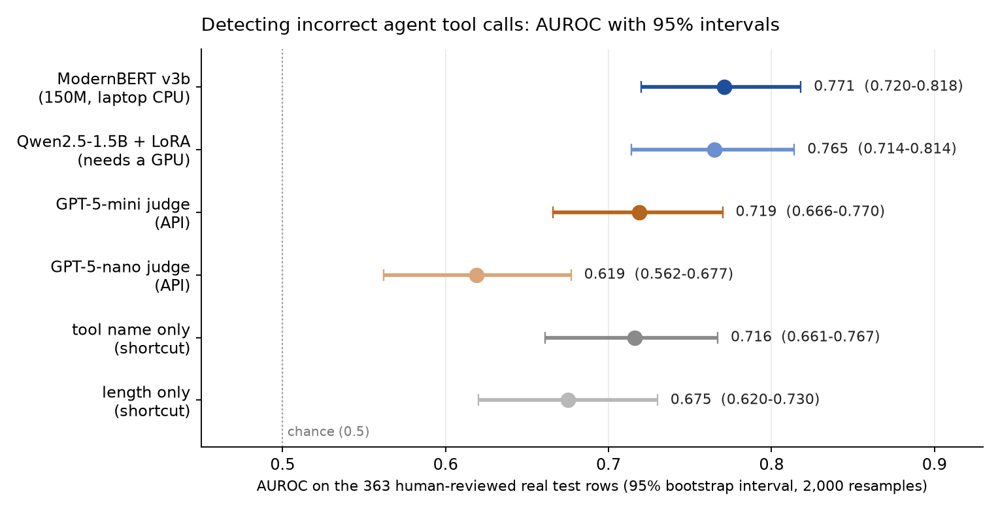
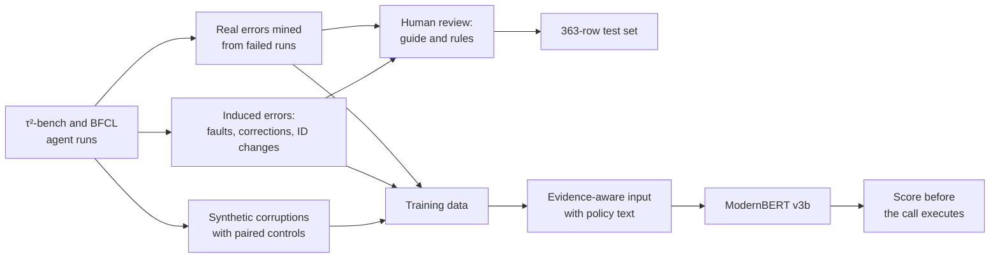

# toolcall-verifier

**A small, local verifier that catches AI-agent tool-call mistakes before they execute.**

[](LICENSE)
[](pyproject.toml)
[](https://huggingface.co/ShaliniSrivastava/toolcall-verifier-modernbert-v3b)
[](https://huggingface.co/datasets/ShaliniSrivastava/toolcall-verifier-test-set)

**toolcall-verifier checks each tool call an LLM agent is about to make and flags likely mistakes before they execute. It's a ~150M-parameter model that runs on a laptop CPU in about 0.7 s (GPT-5-mini: 3.9 s), at no API cost per call and with conversations that never leave your machine. At catching real agent mistakes, it scores 0.771 AUROC, above a GPT-5-mini judge's 0.719, and significantly beats GPT-5-nano (0.619) and the length shortcut (0.675).**



## Results

On the **363-row human-reviewed test set**: 170 incorrect calls (98 natural, 72 induced) and 193 correct calls. AUROC with a 95% bootstrap interval (2,000 resamples). "Recall at 5% / 10% false alarms" is the share of errors caught at the threshold where 5% / 10% of the correct calls are flagged.

| scorer | AUROC overall | natural rows | induced rows | recall at 5% | at 10% |
|---|---|---|---|---|---|
| **ModernBERT v3b** (final model) | **0.771** (0.720-0.818) | 0.753 (0.699-0.807) | 0.724 (0.606-0.832) | 0.229 | 0.329 |
| Qwen2.5-1.5B + LoRA | 0.765 (0.714-0.814) | 0.803 (0.753-0.853) | 0.533 (0.370-0.691) | 0.106 | 0.218 |
| *average of the two (exploratory)* | 0.780 (0.730-0.825) | 0.785 (0.733-0.838) | 0.676 (0.533-0.806) | 0.124 | 0.312 |
| GPT-5-mini judge | 0.719 (0.666-0.770) | 0.695 (0.620-0.760) | 0.698 (0.567-0.820) | 0.100 | **0.471** |
| GPT-5-nano judge | 0.619 (0.562-0.677) | 0.623 (0.549-0.691) | 0.586 (0.449-0.728) | 0.112 | 0.229 |
| tool name only (shortcut) | 0.716 (0.661-0.767) | 0.705 (0.643-0.765) | 0.579 (0.440-0.718) | 0.076 | 0.135 |
| length only (shortcut) | 0.675 (0.620-0.730) | 0.626 (0.556-0.693) | 0.559 (0.424-0.700) | 0.212 | 0.329 |

- On this 363-row test set, the difference from GPT-5-mini is within the confidence interval (paired 95% CI includes zero); a larger test set would be needed to confirm the gap. The gap to the tool-name shortcut (+0.055) has a paired interval of +0.001 to +0.108 overall and includes zero on natural rows; the gaps to GPT-5-nano (+0.151) and the length shortcut (+0.096) have intervals above zero.
- Qwen and ModernBERT are tied overall (-0.006, paired interval -0.052 to +0.037). Qwen is ahead on natural rows (+0.049) and behind on induced rows (-0.191); both are borderline findings among many comparisons. The average of the two is exploratory and shows no demonstrated gain.
- The Kaggle evaluation report quotes ModernBERT's interval as 0.720-0.820 (1,000 resamples); the table and chart use the 2,000-resample intervals of the paired analyses.
- Per-class and per-domain results and the paired tests are in the [writeup](docs/writeup.md) and the [model card](docs/model_card.md).

## Why you can trust these numbers

- **A human-reviewed test set.** 363 real calls from benchmark runs (the conversations are model-generated; the labels are not); every row was reviewed by a human under a written [labeling guide](docs/labeling_guide.md) with consistency rules (for example, a read-only lookup is never a policy violation). Written rules then adjusted some labels without a second look: 34 calls first marked wrong were changed to correct, and 26 accepted errors on telecom line lookups were removed.
- **Shortcut baselines next to every result.** Length alone and tool name alone are scored like any model; both are in the table.
- **Paired bootstrap comparisons.** All scorers see the same rows, and differences are resampled together.
- **Natural and induced errors reported separately.** Induced errors (faults we inject into real runs) come from a different agent and user simulator and behave differently, so they never hide inside one number.
- **No test data in training.** The split is by task, with automated leakage checks (no shared task, no duplicate conversation text).
- **Documented end to end.** A [runbook](docs/kaggle_runbook.md), SHA-256 hashes of the data files and weights, and a [decision log](docs/decision_log.md). The test set and the model are published; the training data is not, so rebuilding it needs the original benchmarks.

## The problem

Agents now take real actions: they cancel orders, change bookings and refund customers. A tool call can be perfectly well formed and still wrong, and one wrong call costs money or trust; a schema validator cannot see that the customer corrected the address two turns ago. Checking the call before it executes is the missing safety layer. This project trains a classifier that reads the conversation so far plus one proposed call and returns the probability that the call is incorrect.

A real test example the model catches (a telecom conversation from τ²-bench, shortened):

```text
User:   My phone number is 555-123-2002.
Agent → get_customer_by_phone(phone_number="555-123-2002")   returns customer C1001 (lines L1001, L1002, L1003)
Agent → get_details_by_id(id="L1001"), get_details_by_id(id="L1002")
Proposed call → get_customer_by_phone(phone_number="555-123-2002")        <- the same lookup again

Verifier score 0.999 (flagged above 0.731).  Human label: incorrect, Class 4 (repeated call).
```

## How it works



The training data mixes synthetic corruptions (each paired with a control that keeps the artifact but removes the error), 220 real errors mined from failed benchmark runs, and induced errors. Real-origin rows are shown three times per epoch. Every test row was reviewed by a human; written rules adjusted some labels. The model input is the last 30 turns with tool results shown in full when they contain a value of the candidate call, the policy text of the candidate's tool, and the candidate call last, at most 4,096 tokens. Training is ModernBERT-base, 3 epochs, one Kaggle T4, 1.9 hours (7,154 training rows, 749 validation rows).

## Key findings

- **Real labeled data appears to have been the lever.** ModernBERT's AUROC was 0.667 with 16 real training errors, 0.732 with 94 and 0.771 with 220 (the last step also added tool balancing, so this is a trend, not a controlled experiment).
- **A 10× bigger model did not help on real errors.** Qwen2.5-1.5B scores 1.000 on held-out synthetic errors (ModernBERT: 0.756) but 0.765 against 0.771 on real ones.
- **Showing the model the evidence is necessary, not sufficient.** The first input showed a median 11% of tool-result text, the evidence-aware input 93%; AUROC moved only from 0.655 to 0.686 (interval 0.535-0.834, 102 rows) until real training data arrived.
- **Shortcuts were found, measured and partly fixed.** Length alone gives 0.675 and tool name alone 0.716. An earlier model scored all 20 test `cancel_reservation` calls with a median of 0.99 (a tool-name shortcut); after tool balancing the median on the 14 correct ones is 0.17, though 5 of 14 still score above 0.9. The induced-run false-flag rate fell from 73% to 27%.

## Error taxonomy

| # | Class | The call ... | Test errors (natural / induced) |
|---|---|---|---|
| 1 | Wrong argument value | uses the right tool with a wrong value | 30 (21 / 9) |
| 2 | Stale state | uses a value the user has since corrected | 4 (0 / 4) |
| 3 | Wrong tool | uses a different tool than the situation calls for | 18 (14 / 4) |
| 4 | Repeated call | repeats an action that already succeeded | 19 (16 / 3) |
| 5 | Failure to propagate | ignores or mis-copies a value from an earlier tool result | 20 (1 / 19) |
| 6 | Ignored error | proceeds as if a failed call had succeeded | 16 (1 / 15) |
| 7 | **Policy violation** | performs an action the domain policy does not allow at that point | 63 (45 / 18) |

Class 7 carries a sub-reason (`no_confirmation`, `ineligible_state`, `missing_step`, `precondition_error`, `parallel_write`, `other`). Classes 2, 5 and 6 are almost all induced, and Class 2 has four rows, so per-class results for them are not readable.

## Quick start

```bash
git clone https://github.com/Shalini-Srivastavaaa/toolcall-verifier && cd toolcall-verifier
pip install torch transformers huggingface_hub
hf download ShaliniSrivastava/toolcall-verifier-modernbert-v3b --local-dir models/final_v3b
```

```python
from verifier.predict import load, score
load("models/final_v3b")
turns = [{"role": "user", "content": "Hi, I want to cancel order #W2378156, I ordered it by mistake."}, {"role": "assistant_tool_call", "name": "get_order_details", "arguments": {"order_id": "#W2378156"}}, {"role": "tool", "content": "{\"order_id\": \"#W2378156\", \"status\": \"pending\", \"items\": []}"}, {"role": "assistant", "content": "The order is pending, so I can cancel it. Please confirm the order id and the reason (ordered by mistake)."}, {"role": "user", "content": "Yes, #W2378156, ordered by mistake. Please cancel it."}]
v = score(turns, {"name": "cancel_pending_order", "arguments": {"order_id": "#W2378156", "reason": "ordered by mistake"}}, domain="retail", operating_point="fa10")
print(v.probability, v.flagged)   # about 0.02, False
```

`fa05` and `fa10` flag 5% and 10% of the correct test calls (recall 0.23 and 0.33); `default` is 0.5. These thresholds were set on the test set. Try twelve real examples in the [local demo](#run-the-demo-locally) or get the weights from the [model page](https://huggingface.co/ShaliniSrivastava/toolcall-verifier-modernbert-v3b) and the 363 human-labeled test rows from the [dataset page](https://huggingface.co/datasets/ShaliniSrivastava/toolcall-verifier-test-set).

## Run the demo locally

A Gradio demo scores twelve real, human-labeled test calls (and your own edits) and shows the policy text the model saw next to the human label. Its code is in [`release/space/`](release/space/). A hosted copy is not published yet (free Gradio hosting on Hugging Face needs a paid plan); the code is a ready Space and can be uploaded later.

```bash
git clone https://github.com/Shalini-Srivastavaaa/toolcall-verifier && cd toolcall-verifier/release/space
python -m venv .venv && source .venv/bin/activate
pip install -r requirements.txt gradio==6.32.0      # pinned torch, transformers, huggingface_hub, safetensors
python app.py                                        # opens http://localhost:7860; the first start downloads the model (about 600 MB) from the Hub
```

Set `MODEL_DIR=/path/to/model` to use a local copy of the weights instead. Checked: example 1 scores 0.025 and example 5 scores 0.998, the saved values.

## Speed and cost

| scorer | where it runs | latency per call | API cost per call |
|---|---|---|---|
| **ModernBERT v3b** | laptop CPU (Apple M5, 4 threads, fp32) | **0.68 s** median, 2.3 s at the 95th percentile | none |
| ModernBERT v3b | Kaggle T4, batched | 0.037 s per row | none |
| Qwen2.5-1.5B + LoRA | Kaggle T4, batched | 0.224 s per row | none |
| GPT-5-mini judge | OpenAI API | 3.9 s median, 8.4 s at the 95th percentile | $0.0012 |
| GPT-5-nano judge | OpenAI API | 2.9 s median, 5.2 s at the 95th percentile | $0.00026 |

The T4 figures are batch throughput, not single-request latency; the judge latencies are recorded wall-clock times of the API calls.

## Limitations

- **Small, reused test set.** 363 rows with 170 errors (98 natural): intervals are about ±0.05, the set was used to choose among model runs, and the shipped thresholds come from the same rows. On this 363-row test set, the difference from GPT-5-mini is within the confidence interval (paired 95% CI includes zero); a larger test set would be needed to confirm the gap.
- **It misses most errors at strict settings**: recall 0.33 at a 10% false-alarm rate, where the GPT-5-mini judge reaches 0.47. It is a triage signal, not a gate.
- **Shortcuts and brittleness.** Length and tool name alone give AUROC 0.675 and 0.716; induced runs have a signature the model can learn; a few hand-made probes showed scores that change with phrasing (0.02 against 0.88 for the same call) and a clear policy violation that was not flagged.
- **One kind of agent.** Customer-service dialogue in three τ²-bench domains plus BFCL; nothing is known about other tools or domains.
- **Labels.** One reviewer under a written guide, not adjudicated; the Class 7 sub-reasons are mostly heuristic tags.
- **Data terms.** Some data is text generated by commercial models (the test-set conversations are model-generated). The project owner reviewed the providers' terms: outputs are owned by the user under the OpenAI and Anthropic terms, and nothing here is used to build competing models (see the license audit).

## Repository and documents

```
verifier/        inference package (predict.py, data/, check_against_saved.py)
release/         test_set/ (public test set), hf_model/ (Hugging Face model folder), space/ (Gradio demo)
docs/            writeup, model card, license audit, labeling guide, runbook, decision log, figures/
notebooks/       Kaggle notebooks of the final runs (kaggle_phase5_modernbert, kaggle_phase6_qwen), their generators, legacy Colab originals
eval/            analysis, baselines and judge scripts          data/   dataset-building scripts (they need data not published here)
results/         predictions and analysis outputs of the runs   scripts/ release and chart scripts
```

[Writeup](docs/writeup.md) · [Model card](docs/model_card.md) · [Full decision log](docs/decision_log.md) · [License audit](docs/licenses.md) · [Release steps](docs/release_steps.md)

**License.** Code and model weights: Apache-2.0 ([`LICENSE`](LICENSE), [`NOTICE`](NOTICE), [`THIRD_PARTY_NOTICES.md`](THIRD_PARTY_NOTICES.md)). Human labels of the test set: CC BY 4.0; the τ²-bench content in it: MIT ([`DATA_LICENSE.md`](DATA_LICENSE.md)).

**Citation.**

```bibtex
@misc{srivastava2026toolcallverifier,
  author = {Srivastava, Shalini},
  title  = {toolcall-verifier: a small local verifier for AI-agent tool calls},
  year   = {2026},
  url    = {https://github.com/Shalini-Srivastavaaa/toolcall-verifier}
}
```
